# hairline

**Clean, predictable figures for medical and data science, in Python and R.**

[](python/LICENSE)
[](python/README.md)
[](r/README.md)
[](https://doi.org/10.5281/zenodo.23456211)

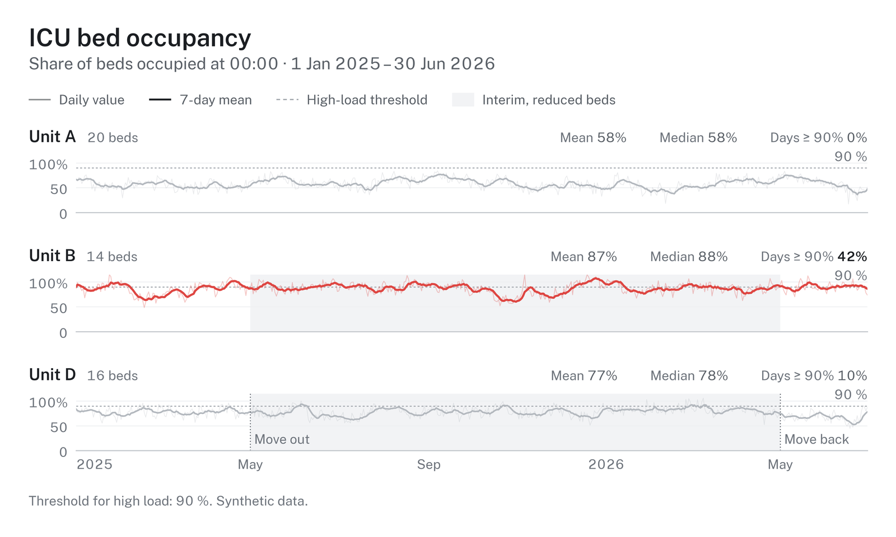

hairline is a design system for scientific figures, as a pair of packages that draw the same figure in either
language: one frame for titles, legends, panels and captions, one type scale, colour-vision checked palettes,
and files ready for a journal, a report or a slide. You choose the data and the chart; hairline makes the
hundred small layout decisions, the same way every time.

- **One call per chart.** Nineteen chart types, from bar charts to Kaplan–Meier curves, forest plots, Sankey
  and PRISMA diagrams, each from a data frame and its column names.
- **The same figure in Python and R.** Both packages read one set of design tokens; a check runs every gallery
  figure in both languages and compares their layouts point by point.
- **Results, not only plots.** `study()` checks a data set once and returns a cohort description, group
  comparisons, effects, survival and change over time, each as a figure, a table, the key values and a
  sentence for the text.
- **Colours that hold.** Palettes checked for colour-blind readers, and a group keeps its colour in every chart.
- **Your institution's design.** One `_brand.yml` sets colours, fonts, text sizes and number format, in layers
  from institution to document and per export type.
- **Files ready to use.** PDF with embedded fonts, PNG and TIFF at 600 dpi, SVG with text as text, and
  interactive HTML with tooltips; files carry the figure's title and no timestamps.

## Install

```bash
pip install hairline
```

```r
install.packages("hairline")
```

Python 3.11 or later with matplotlib 3.11 or later; R 4.3 or later with ggplot2 4.0 or later. The bundled
font, Hairline Sans, needs no installation.

## From data to a result

Describe a cohort once, with the role of each column; hairline checks the data and returns Table 1 with its
figure. Run from the repository root, both give the figure below.

```python
import pandas as pd
import hairline as hl

cohort = pd.read_csv("gallery/data/cohort.csv")
study = hl.study(cohort, group="arm", time="months", event="died", id="id",
                 variables=["age", "sex", "sofa", "lactate"], labels={"sofa": "SOFA score", "lactate": "Lactate"},
                 units={"age": "years", "sofa": "points", "lactate": "mmol/l", "months": "months"})
overview = study.describe()      # .table (Table 1), .figure, .values, .text
hl.save(overview.figure, "cohort", formats=["pdf", "png"])
```

```r
library(hairline)

cohort <- read.csv("gallery/data/cohort.csv")
study <- hl_study(cohort, group = "arm", time = "months", event = "died", id = "id",
                  variables = c("age", "sex", "sofa", "lactate"), labels = c(sofa = "SOFA score", lactate = "Lactate"),
                  units = c(age = "years", sofa = "points", lactate = "mmol/l", months = "months"))
overview <- hl_describe(study)   # $table (Table 1), $figure, $values, $text
hl_save(overview$figure, "cohort", formats = c("pdf", "png"), size = "double")
```

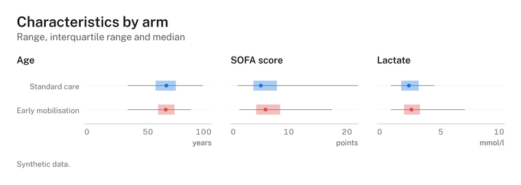

The same study gives `compare()`, `distribution()`, `effects()`, `survival()` and `over_time()` in Python,
and `hl_compare()`, `hl_distribution()`, `hl_effects()`, `hl_survival()` and `hl_over_time()` in R.

## Saving figures

One call writes every format you need, named after the figure and in a folder that is created if it is missing:

```python
hl.save(overview.figure, "figures/cohort", formats=["pdf", "png", "svg", "tiff", "html"])
```

```r
hl_save(overview$figure, "figures/cohort", formats = c("pdf", "png", "svg", "tiff", "html"), size = "double")
```

| Format | For | What you get |
|---|---|---|
| `pdf` | journals, print | vector graphics with the font embedded; text stays selectable |
| `png` | slides, Word, the web | 600 dpi by default (`dpi=`) |
| `tiff` | journals that ask for TIFF | 600 dpi, LZW-compressed |
| `svg` | editing, the web | vector graphics with text kept as text |
| `html` | reports and web pages | an interactive figure in one self-contained file |

**Sizes.** `size=` picks a preset, and the text size follows it: `"single"` (85 mm, a journal's single
column), `"onehalf"` (120 mm), `"double"` (174 mm, two columns), `"a4"` (160 mm) and `"slide"` (254 × 143 mm,
larger text). `width_mm=` and `height_mm=` set the size exactly. In Python the size belongs to the figure
(`hl.figure(..., size="double")`, `hl.bars(..., size="double")`); in R it is given when saving
(`hl_save(plot, "name", size = "double")`). Charts whose height follows their content, such as forest plots
and Sankey diagrams, size themselves.

**Every file** carries the figure's title and subtitle as its description and no timestamp;
`background="transparent"` leaves out the white surface.

### Interactive HTML

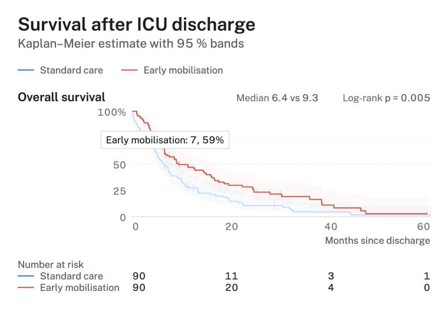

- **Hover** a line, point, bar or segment: everything else fades and a tooltip shows its values, written in the
  figure's number format.
- **Legend:** hovering an entry brings its series forward. **Keyboard:** Tab moves through the series.
- **One file:** the figure as SVG with its font, script and styles inside. It works offline, opens in any
  browser, and its `<figure>` element can be placed in another HTML page or report as it is. The figure's title
  and subtitle are its accessible name for screen readers.

## Gallery

Every figure below comes from one short script in each language, on synthetic data; select a figure for its
Python script, and find the R script of the same name in [`gallery/r`](gallery/r).

### Groups and distributions

<table>
<tr><td width="33%" valign="top"><a href="gallery/python/bars_admissions.py">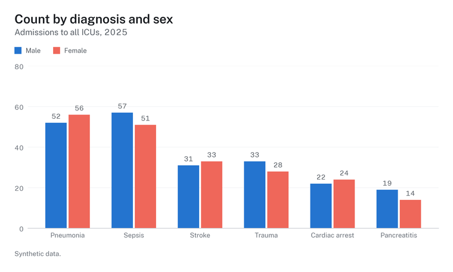</a><br><sub>Bar chart</sub></td><td width="33%" valign="top"><a href="gallery/python/bars_stacked.py">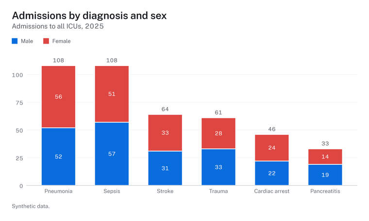</a><br><sub>Stacked bars</sub></td><td width="33%" valign="top"><a href="gallery/python/bars_percent.py">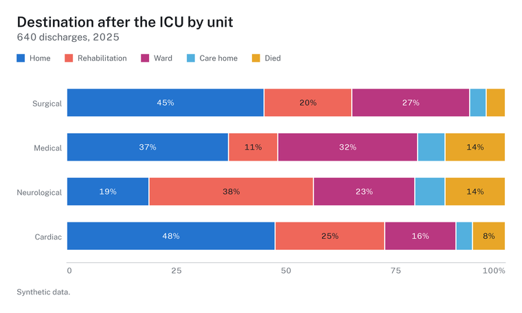</a><br><sub>100 % stacked bars</sub></td></tr>
<tr><td width="33%" valign="top"><a href="gallery/python/dotplot_rates.py">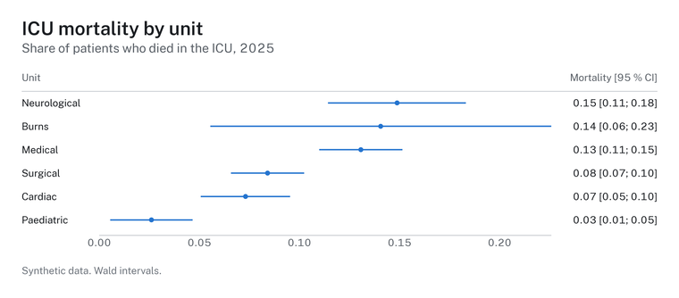</a><br><sub>Dot plot with intervals</sub></td><td width="33%" valign="top"><a href="gallery/python/spread_occupancy.py">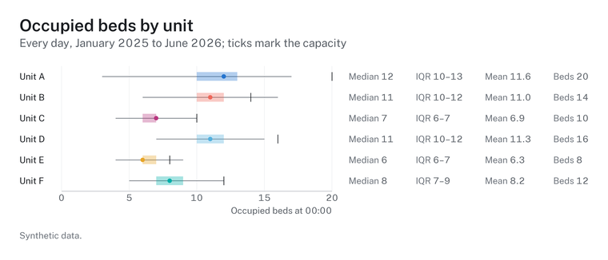</a><br><sub>Spread rows</sub></td><td width="33%" valign="top"><a href="gallery/python/raincloud_stay.py">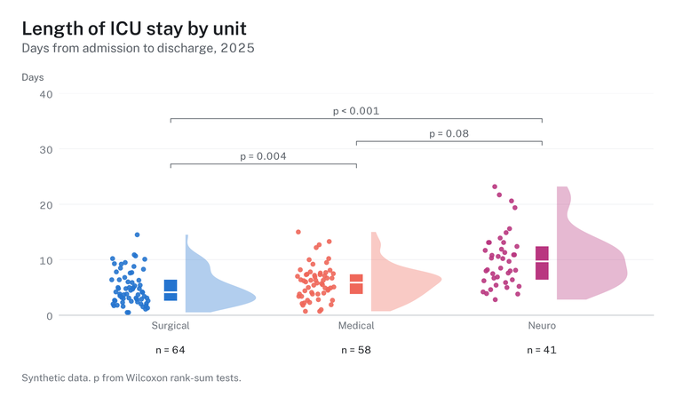</a><br><sub>Raincloud</sub></td></tr>
<tr><td width="33%" valign="top"><a href="gallery/python/ridgeline_ages.py">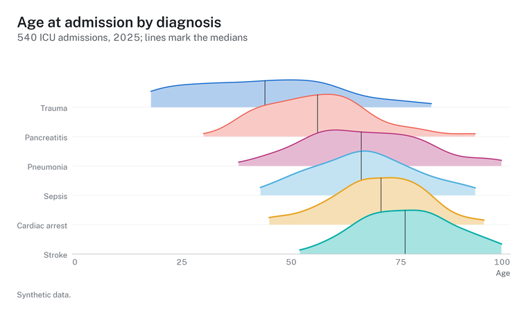</a><br><sub>Ridgeline</sub></td><td width="33%" valign="top"><a href="gallery/python/scatter_fit.py">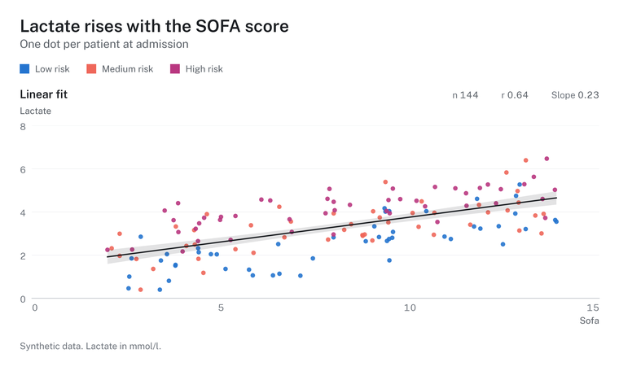</a><br><sub>Scatter with fit</sub></td><td width="33%" valign="top"><a href="gallery/python/correlation_patients.py">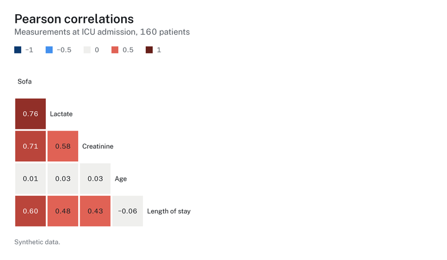</a><br><sub>Correlation heatmap</sub></td></tr>
</table>

### Survival and evidence

<table>
<tr><td width="33%" valign="top"><a href="gallery/python/km_trial.py">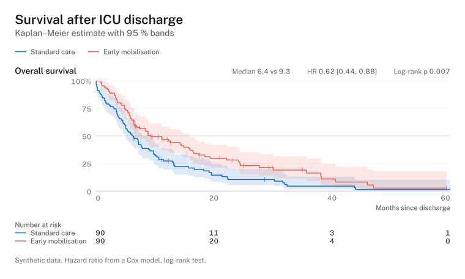</a><br><sub>Kaplan–Meier</sub></td><td width="33%" valign="top"><a href="gallery/python/forest_meta.py">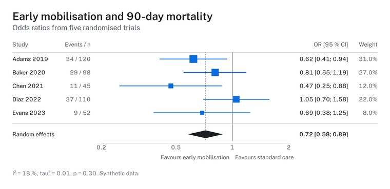</a><br><sub>Forest plot</sub></td><td width="33%" valign="top"><a href="gallery/python/funnel_trials.py">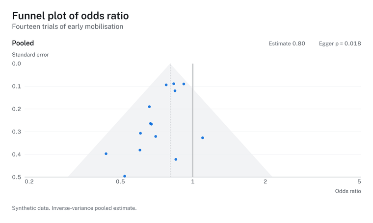</a><br><sub>Funnel plot</sub></td></tr>
<tr><td width="33%" valign="top"><a href="gallery/python/risk_of_bias_trials.py">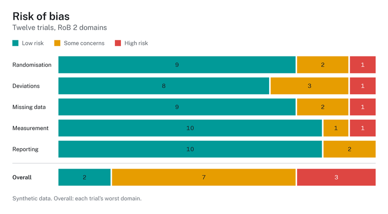</a><br><sub>Risk of bias</sub></td><td width="33%" valign="top"><a href="gallery/python/prisma_review.py">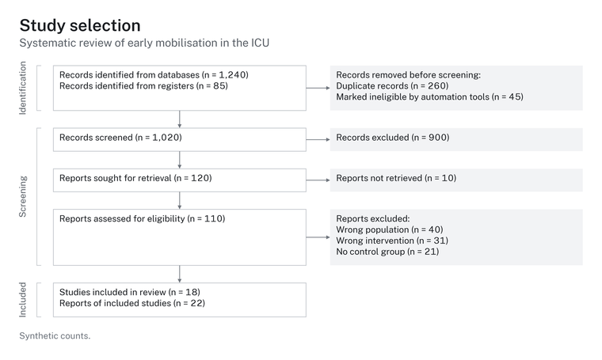</a><br><sub>PRISMA flow</sub></td></tr>
</table>

### Parts, flows and overlaps

<table>
<tr><td width="33%" valign="top"><a href="gallery/python/donut_discharge.py">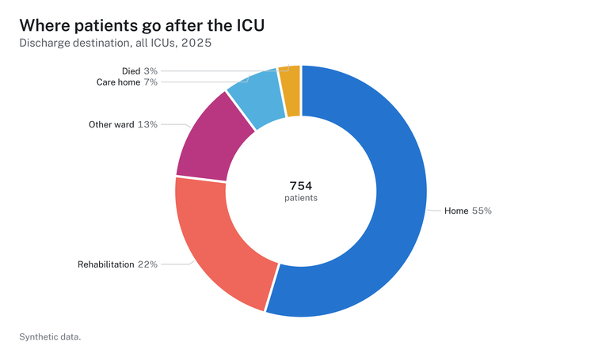</a><br><sub>Donut</sub></td><td width="33%" valign="top"><a href="gallery/python/donut_nested.py">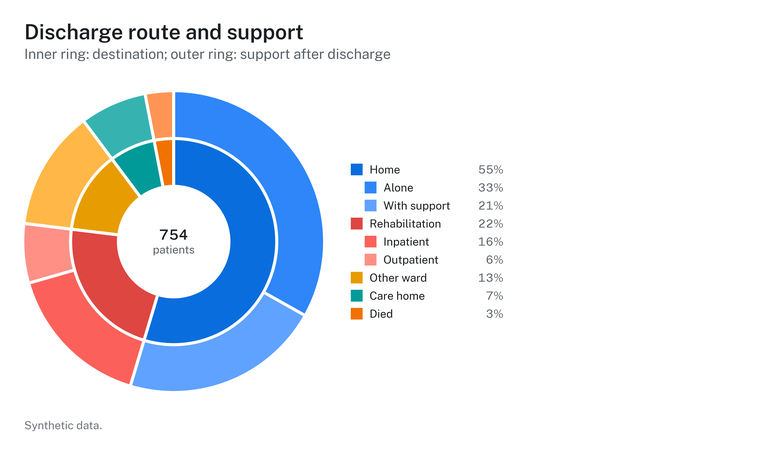</a><br><sub>Nested donut</sub></td><td width="33%" valign="top"><a href="gallery/python/partition_discharge.py">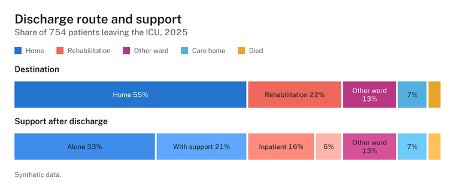</a><br><sub>Partition bars</sub></td></tr>
<tr><td width="33%" valign="top"><a href="gallery/python/sankey_budget.py">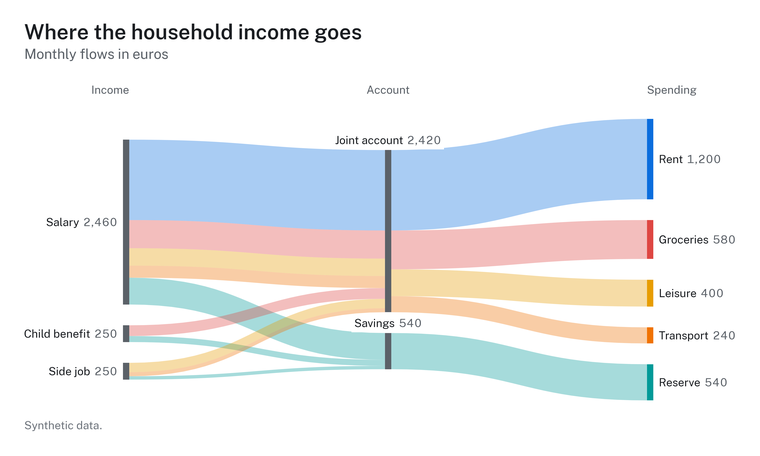</a><br><sub>Sankey</sub></td><td width="33%" valign="top"><a href="gallery/python/arcs_pathways.py">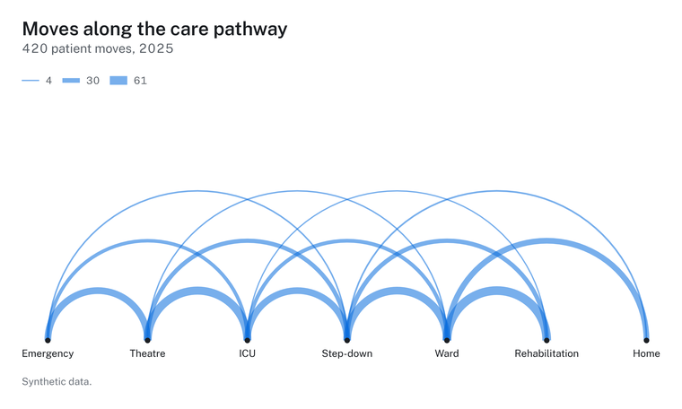</a><br><sub>Arc diagram</sub></td><td width="33%" valign="top"><a href="gallery/python/chord_transfers.py">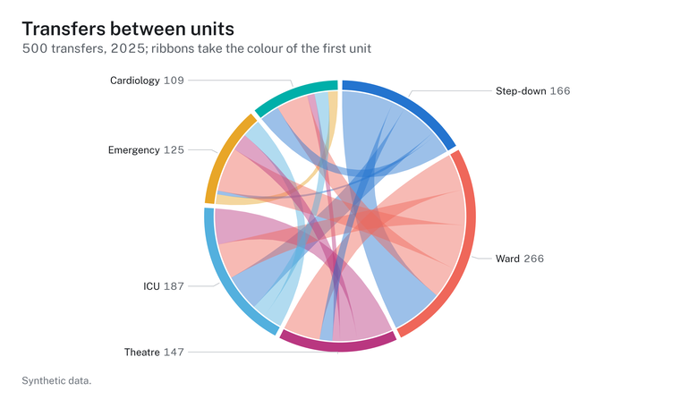</a><br><sub>Chord diagram</sub></td></tr>
<tr><td width="33%" valign="top"><a href="gallery/python/venn_comorbidities.py">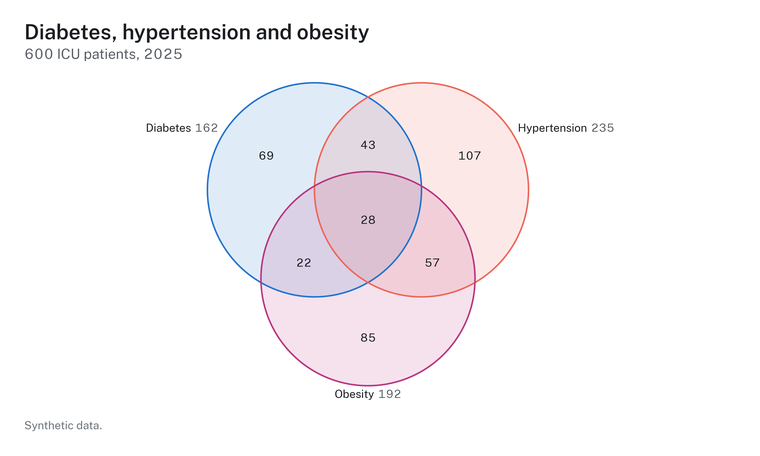</a><br><sub>Venn diagram</sub></td></tr>
</table>

### Time, panels and studies

<table>
<tr><td width="33%" valign="top"><a href="gallery/python/occupancy_rows.py">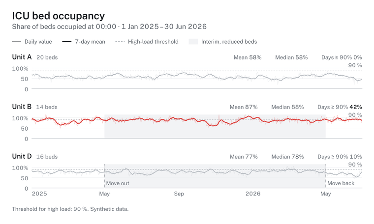</a><br><sub>Time series, two levels of detail</sub></td><td width="33%" valign="top"><a href="gallery/python/grid_panels.py">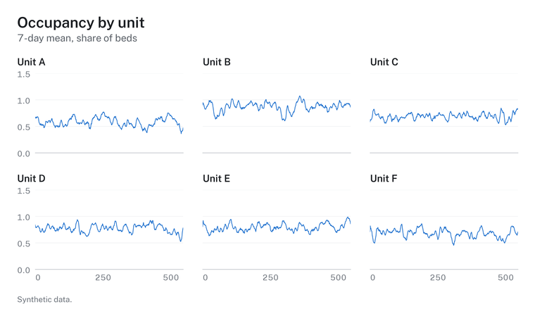</a><br><sub>Small multiples</sub></td><td width="33%" valign="top"><a href="gallery/python/study_describe.py"></a><br><sub>Study: cohort overview</sub></td></tr>
<tr><td width="33%" valign="top"><a href="gallery/python/brand_example.py">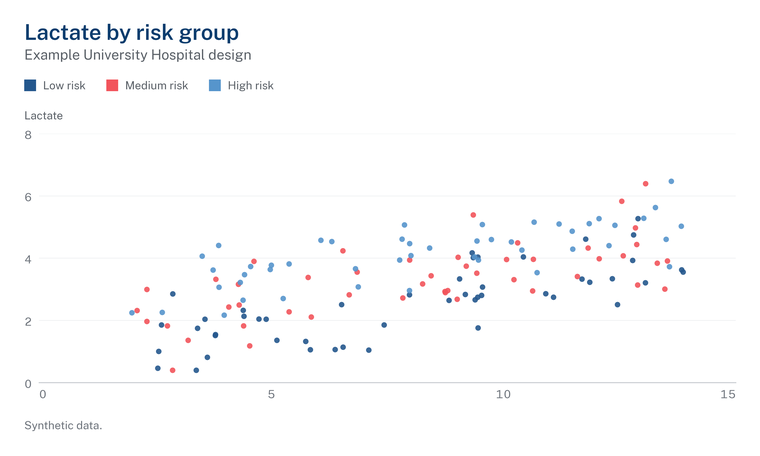</a><br><sub>Brand file</sub></td></tr>
</table>

## The same figure in Python and R

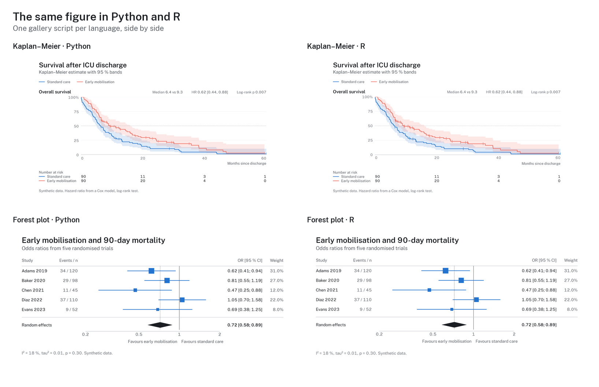

`tools/parity.py` runs every gallery script in both languages and compares the frame positions, legends and
tooltips of each figure; they agree to within a point.

## Colours

Six categorical palettes, purpose sets for two groups, greyscale print and risk of bias, and ramps for
amounts. `palettes()` lists them, `swatches()` draws them, `use(palette="calm")` changes the default, and a
brand file can pin a colour to every unit or arm. The [colour guide](docs/guide/colours.md) explains which set
to use for which job.

<a href="docs/guide/colours.md">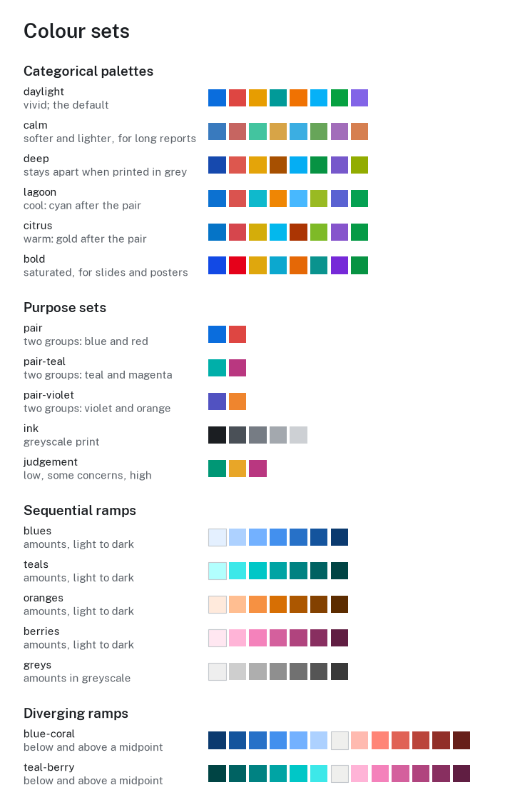</a>

## Brands

An institution's look lives in one `_brand.yml` file, in the [brand.yml](https://posit-dev.github.io/brand-yml/)
format. hairline takes its colours, fonts, text sizes and number format from
it and keeps its own layout rules, so a branded figure is still a clean hairline figure.

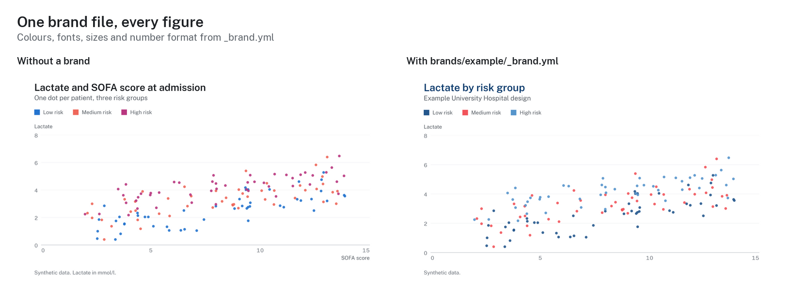

```yaml
meta:
  name: Example University Hospital
color:
  palette:
    harbor: "#0b3d6e"
    poppy: "#f2545b"
    glacier: "#8cc8ff"
    fern: "#7fd8a0"
  foreground: harbor
  background: "#ffffff"
  primary: harbor
typography:
  fonts:
    - family: Hairline Sans
      source: system
  base:
    family: Hairline Sans
  headings:
    family: Hairline Sans
    weight: 600
defaults:
  hairline:
    categorical: [harbor, poppy, glacier, fern]
    adapt: readable
    base_size: 9
    sizes:
      title: 14
    locale: de
```

```python
hl.use(brand="brands/example/_brand.yml")              # or let hairline find _brand.yml itself
hl.use(brand=["brands/example/_brand.yml", "brands/example/units.yml"], output="docx")
print(hl.brand_report())                               # each colour as given and used, its layer, the checks
```

```r
hl_use(brand = "brands/example/_brand.yml")
hl_use(brand = c("brands/example/_brand.yml", "brands/example/units.yml"), output = "docx")
cat(hl_brand_report())
```

- **Found on its own.** Without `brand=`, hairline looks for `_brand.yml` in the working directory and its
  parents up to the project root and says once which brand it uses; `brand=False` turns the
  lookup off.
- **Colours.** `categorical` orders the palette's colours for groups. `adapt: readable` keeps each hue and
  nudges its lightness until the colours pass the colour-vision and contrast checks; `adapt: exact` uses them
  as given and warns. `colors:` pins a colour to a unit or arm, `groups:` gives a section's units tints of the
  section's colour.
- **Ramps.** `sequential:` and `diverging:` name the colours whose hues make the brand's own ramps,
  `brand-sequential` and `brand-diverging`; without them the brand's first one and two colours do. While the
  brand is active they are the default for heatmaps and continuous colour scales.
- **Fonts and text.** A font from the system or from a file next to the brand (`source: file`); a Google font
  needs installing first. `base_size` and `sizes` set the type scale, `locale: de` writes decimal commas, and
  `muted`, `faint`, `grid`, `axis` and `band` set the neutral greys.
- **Layers.** Files stack from institution to project to document, each overriding only the keys it sets, as
  [`brands/example/units.yml`](brands/example/units.yml) does over the institution's file; the brand report
  names the layer each colour came from.
- **Per export type.** `outputs:` holds overrides for `screen`, `pdf`, `html` or `docx`, such as a larger
  text size for Word; `use(output="docx")` or the document editor picks the one that applies.
- **In a document.** A document editor that runs code can pass the document's brand layers, export type
  and page width to hairline, so every figure in a Word, PDF or HTML export follows the same design.

## Documentation

- [Python package](python/README.md) and [R package](r/README.md): install, quick start, charts, files.
- [Colour guide](docs/guide/colours.md): the colour sets, choosing one, colours that follow names, brands.
- In R, every function has a help page with examples (`?hl_bars`), and `?hairline_colours` covers colour; in
  Python, `help(hl.bars)` and `help(hairline.palettes)`.

## How to cite

If hairline helped you make the figures in your work, please cite it: [doi:10.5281/zenodo.23456212](https://doi.org/10.5281/zenodo.23456212) for
version 0.1.0, or [doi:10.5281/zenodo.23456211](https://doi.org/10.5281/zenodo.23456211) for every version. GitHub's "Cite this repository" button
reads [`CITATION.cff`](CITATION.cff); each package prints its reference:

```python
import hairline as hl

print(hl.citation())             # Schrader N (2026). hairline: ... Python package version 0.1.0.
print(hl.citation("bibtex"))
```

```r
citation("hairline")
```

```bibtex
@Manual{schrader2026hairline,
  title = {hairline: Clean, Predictable Figures for Medical and Data Science},
  author = {Nikolas Schrader},
  year = {2026},
  note = {Python package version 0.1.0},
  doi = {10.5281/zenodo.23456212},
}
```

Cite the package you used: in R, the note reads "R package version 0.1.0".

## Author

Nikolas Schrader (<hi@nikolasschrader.com>), ORCID
[0009-0001-4616-3804](https://orcid.org/0009-0001-4616-3804).

## Working on it

| Folder | Holds |
|---|---|
| `tokens/` | the shared design tokens, font, interactive assets and test fixtures |
| `python/`, `r/` | the two packages; `tools/sync_tokens.py` copies the tokens into each |
| `gallery/` | one script per figure in each language, on synthetic data from `gallery/data/make_data.py` |
| `brands/example/` | an example brand file |
| `docs/` | the guides and the README images |
| `tools/` | token sync, fixture builders, the font build, the parity check and the image builders |

```bash
python3 tools/sync_tokens.py
```

```bash
cd python && uv run --with lifelines pytest
```

```bash
cd r && Rscript -e 'devtools::test()'
```

```bash
cd python && uv run python ../tools/parity.py
```

`tools/parity.py` runs the gallery in both languages and compares every figure; install the R package first
(`R CMD INSTALL r`). `tools/readme_images.py` and `tools/guide_images.py` rebuild the images of this page and
the colour guide.

## Licence

MIT. The bundled Hairline Sans font is a modified [Public Sans](https://github.com/uswds/public-sans) (SIL Open
Font License 1.1).
