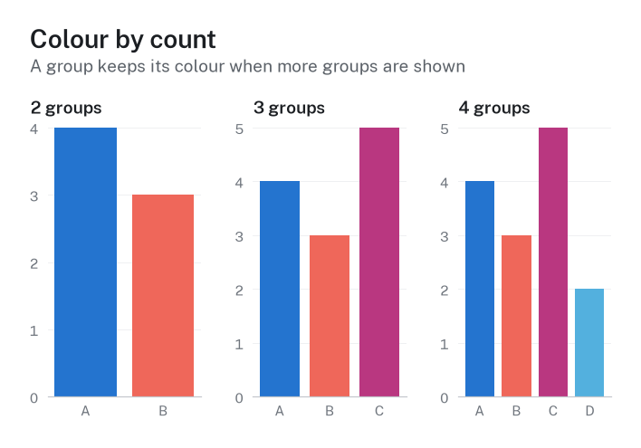
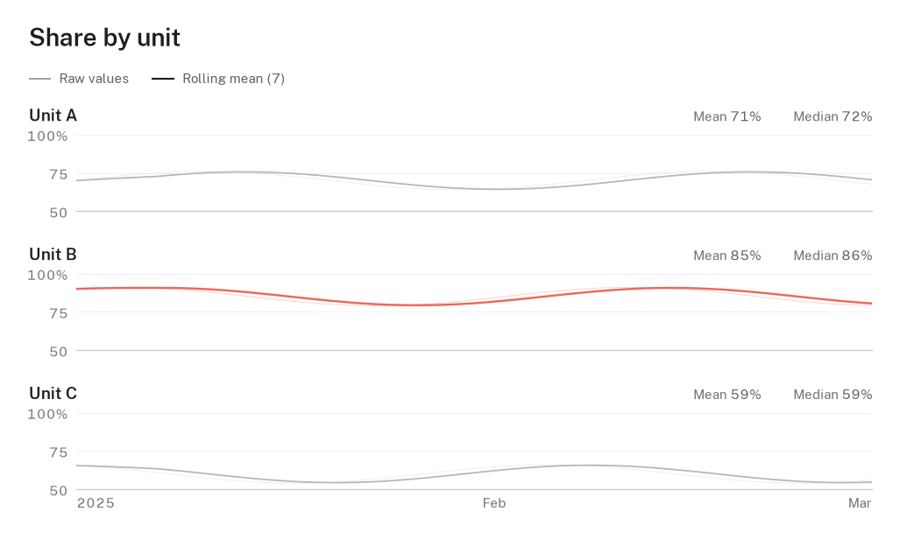

# Colours

hairline picks colours for you: every chart function colours its groups, amounts and highlights on its own.
This guide shows which colour sets there are, how to choose another one, and how to keep a group's colour the
same across a whole report. Every example runs as it is, in Python and in R.


## Which colours for which job

| The colours show | Use | Python | R |
|---|---|---|---|
| groups (arms, units, diagnoses) | a categorical palette | `hl.use(palette="calm")` | `hl_use(palette = "calm")` |
| two groups (intervention, control) | a pair | `hl.use(palette="pair")` | `hl_use(palette = "pair")` |
| a printout in grey | `ink`, or `deep` | `hl.use(palette="ink")` | `hl_use(palette = "ink")` |
| amounts (counts, rates, densities) | a sequential ramp | `hl.colormap("blues")` | `scale_fill_hairline_c("blues")` |
| values above and below a midpoint | a diverging ramp | `hl.colormap("blue-coral")` | `scale_fill_hairline_c("blue-coral")` |
| one group against the rest | a highlight | `highlight=["Unit B"]` | `+ hl_highlight("Unit B")` |
| a single series | the accent | `hl.use(accent="#0b6e4f")` | `hl_use(accent = "#0b6e4f")` |
| risk of bias | `judgement` | applied by `risk_of_bias()` | applied by `hl_risk_of_bias()` |

## See what there is

`palettes()` lists every colour set with its kind, its number of colours, what it is for, and which one is in
use. `swatches()` draws them, as in the figure above; give it names to compare a few.

```python
import hairline as hl

hl.use(brand=False)
hl.palettes()                    # a data frame: name, kind, slots, active, use, colors
hl.palettes("purpose")           # one kind: categorical, purpose, sequential or diverging
hl.palette("calm", n=3)          # the first three colours of a palette
hl.ramp("blues", n=5)            # five steps of a ramp
figure = hl.swatches(["daylight", "calm", "pair", "blues"], title="Colours for this report")
```

```r
library(hairline)

hl_use(brand = FALSE)
hl_palettes()                    # a data frame: name, kind, slots, active, use, colors
hl_palettes("purpose")           # one kind: categorical, purpose, sequential or diverging
hl_palette("calm", n = 3)        # the first three colours of a palette
hl_ramp("blues", n = 5)          # five steps of a ramp
figure <- hl_swatches(c("daylight", "calm", "pair", "blues"), title = "Colours for this report")
```

The six categorical palettes have eight colours each:

| Palette | Character |
|---|---|
| `daylight` | bright and balanced; the default |
| `bloom` | playful, led by magenta |
| `citrus` | sunny, high energy |
| `lagoon` | fresh blue-green with coral |
| `calm` | subdued, for long reports |
| `deep` | dark and light, prints in grey |

The purpose sets cover common cases: `pair`, `pair-teal` and `pair-violet` for two groups, `ink` for strict
greyscale print, and `judgement` for low, some concerns and high.

## Choose a palette for the session

`use(palette=...)` makes a palette or purpose set the default for every chart after it. A list of hex colours
works too; hairline checks it first (see "Your own colours").

```python
hl.use(palette="calm")
```

```r
hl_use(palette = "calm")
```

## Colour by count

The number of groups decides the colours, the same in every chart: two groups take the first two colours,
three groups the first three, and so on. A palette's order is chosen so that the first two, three and four
colours are the most readable set of that size, for colour-blind readers too. Because the sets are nested, a
group keeps its colour when a chart shows more groups.



A palette has eight colours. hairline does not repeat a colour for a ninth group; it stops with an error and
asks you to fold small groups into "Other" or to split the figure into panels.

## Colour follows the name

Within a session, a group keeps the colour it got first in every later chart, even in a chart that shows only
some of the groups. To decide the colours yourself, pin them to names:

```python
hl.use(brand=False, colors={"Unit A": "#2474cf", "Unit B": "#e8a628"})
hl.color("Unit B")               # '#e8a628'
hl.colors()                      # every name with its colour so far
```

```r
hl_use(brand = FALSE, colors = c("Unit A" = "#2474cf", "Unit B" = "#e8a628"))
hl_color("Unit B")               # "#e8a628"
hl_colors()                      # every name with its colour so far
```

For colours that stay the same across a report, whatever order the charts are drawn in, put them in the brand
file (next section).

## Brand colours

A `_brand.yml` file (the [brand.yml](https://posit-dev.github.io/brand-yml/) format) holds an institution's
palette. hairline finds it from the working directory upwards, or takes it by path. Several files layer from
institution to project:

```yaml
color:
  palette:
    harbor: "#0b3d6e"
    poppy: "#f2545b"
    glacier: "#8cc8ff"
defaults:
  hairline:
    categorical: [harbor, poppy, glacier]   # the palette, in slot order
    adapt: readable                         # nudge colours until they pass the checks
    colors:                                 # colours pinned to names
      Unit A: harbor
      Surgery: poppy
    groups:                                 # units that share their section's hue, in tints
      Surgery: [Unit C, Unit D]
    sequential: harbor                      # the hue of the brand's ramp for amounts
    diverging: [harbor, poppy]              # the low and high poles of its diverging ramp
```

```python
hl.use(brand=["_brand.yml", "units.yml"])   # institution first, then the project
hl.brand_report()                           # each colour, the layer it came from, and the check results
```

```r
hl_use(brand = c("_brand.yml", "units.yml"))
hl_brand_report()
```

## Your own colours

Any list of hex colours can be a palette. hairline checks it the way it checks its own: neighbouring colours
must stay apart for colour-blind readers and for everyone else, and each colour's contrast with the background
is measured. `check_palette()` reports the numbers; `pairs="all"` checks every pair, for scatter plots and
small multiples where any two groups can meet.

```python
report = hl.check_palette(["#2474cf", "#2b83c4", "#e8a628"], pairs="all")
report.passed                    # False: the two blues are too close
report.failures                  # what failed, with the measured distances
```

```r
report <- hl_check_palette(c("#2474cf", "#2b83c4", "#e8a628"), pairs = "all")
report$passed
report$failures
```

## Ramps in your own plots

hairline's own charts use ramps where they need one, as the correlation heatmap does. In a plot of your own,
`colormap()` turns a ramp into a matplotlib colormap; in R the continuous scales take the ramp's name. While a
brand is active, its own ramps `brand-sequential` and `brand-diverging` are the default: made from the colours
its `sequential:` and `diverging:` entries name, else from its first one and two colours, and used by
`colormap()` without a name, the continuous scales without a ramp and the heatmap.

```python
import numpy as np

figure = hl.figure("Density", size="single")
image = figure.ax.imshow(np.add.outer(np.arange(10), np.arange(10)), cmap=hl.colormap("blues"))
```

```r
library(ggplot2)
ggplot(faithfuld, aes(waiting, eruptions, fill = density)) + geom_raster() +
  labs(title = "Old Faithful eruptions") + theme_hairline() + scale_fill_hairline_c("teals")
```

## One group against the rest

A highlight keeps the named groups in colour and draws the others in a context grey, behind them.

```python
import pandas as pd

days = np.arange(60)
waves = [level + 0.06 * np.sin(days / 6 + shift) for level, shift in ((0.7, 0), (0.85, 1), (0.6, 2))]
occupancy = pd.DataFrame({"date": list(pd.date_range("2025-01-01", periods=60)) * 3,
                          "unit": np.repeat(["Unit A", "Unit B", "Unit C"], 60), "share": np.concatenate(waves)})
figure = hl.timeseries(occupancy, "date", "share", by="unit", percent=True, highlight=["Unit B"])
```

```r
waves <- lapply(list(c(0.7, 0), c(0.85, 1), c(0.6, 2)), function(wave) wave[1] + 0.06 * sin(0:59 / 6 + wave[2]))
occupancy <- data.frame(date = rep(as.Date("2025-01-01") + 0:59, 3),
                        unit = rep(c("Unit A", "Unit B", "Unit C"), each = 60), share = unlist(waves))
figure <- hl_timeseries(occupancy, "date", "share", by = "unit", percent = TRUE, highlight = "Unit B")
```



## A single series, and dark backgrounds

A chart without groups (one bar series, one survival curve, a forest plot) draws in the accent: the first
palette colour unless you give one, shaded darker until it reaches 3:1 against the background. Grouped charts
never use the accent, so groups look the same in every figure. A dark scheme swaps the background, text and
grid greys for dark ones; the data colours stay, and points and thin lines are shaded lighter where they would
sink into the dark surface.

```python
hl.use(brand=False, accent="#0b6e4f", scheme="dark")
hl.use(brand=False)              # back to the defaults
```

```r
hl_use(brand = FALSE, accent = "#0b6e4f", scheme = "dark")
hl_use(brand = FALSE)
```

## Light colours

Some palette colours are light: their contrast with a white background is below 3:1 (in `daylight`, the
colours in slots 4, 5, 6 and 8). hairline keeps them as they are for areas such as bars and donut segments,
draws lines in them a little wider, and fills points with a darker shade of the same hue, so thin marks stay
visible. Text never takes a data colour; labels and values stay in the text greys next to the coloured mark.
