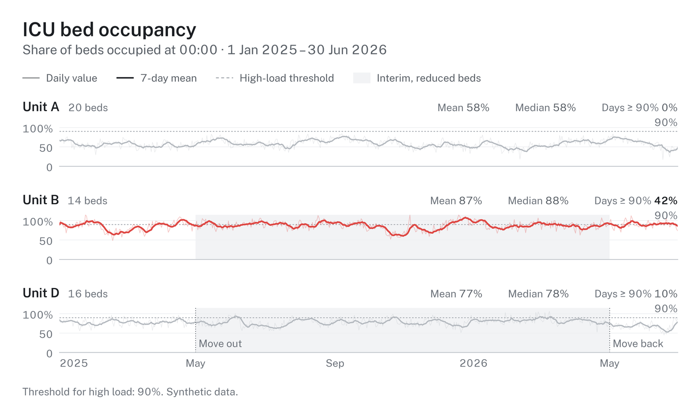
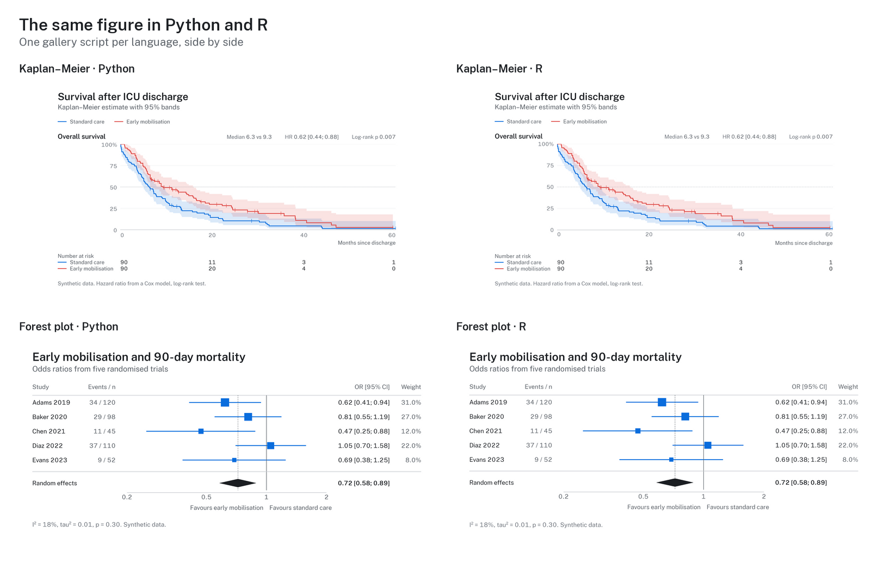

# hairline

Clean, predictable figures for medical and data science. One frame for titles, legends, panels and captions,
one type scale, colour-vision checked palettes, and print-ready files. The R package of the same name draws
the same figures from the same design tokens, so a Python figure and an R figure in one manuscript match.

```bash
pip install hairline
```

The development version, with changes not yet released (see the [changelog](CHANGELOG.md)), installs from GitHub:
`pip install "hairline @ git+https://github.com/schradern/hairline#subdirectory=python"`.

Python 3.11 or later, matplotlib 3.11 or later: from 3.11 matplotlib kerns text as R does, so both packages
place every label alike. The bundled font, Hairline Sans, needs no installation.



## From data to a result

Most studies need the same few results: a cohort description, a comparison between groups, effects, events
over time. `study()` takes a data frame once, with the role of each column, checks the data, and returns each
result as a figure, a table, the key values and a sentence for the text.

```python
import numpy as np
import pandas as pd
import hairline as hl

rng = np.random.default_rng(1)
cohort = pd.DataFrame({
    "arm": np.repeat(["Standard care", "Early mobilisation"], 40),
    "age": rng.normal(64, 12, 80).round(),
    "sex": rng.choice(["Female", "Male"], 80),
    "months": rng.exponential(20, 80).round(1),
    "died": rng.binomial(1, 0.4, 80),
})
study = hl.study(cohort, group="arm", time="months", event="died",
                 units={"age": "years", "months": "months"})

table_one = study.describe()     # Table 1: median (IQR) and n (%) per group
table_one.table                  # a data frame
age = study.compare("age")       # spread rows per group, Wilcoxon rank-sum
age.text                         # "Age (years), median (IQR): ... (Wilcoxon rank-sum, p = ...)."
age.numbers["test"]["p"]         # the unrounded p the text formats
survival = study.survival()      # Kaplan–Meier with numbers at risk and the log-rank test
hl.save(survival.figure, "survival")              # survival.pdf and survival.png
```

Printing a study lists its checks: missing values, duplicate ids, categories that differ only in case,
small groups, numeric columns without a unit. Errors stop the analysis; warnings name the fix. With `id=`,
`describe()`, `compare()` and `distribution()` refuse a variable with more than one row per id, so repeated
measurements are not counted as separate patients.

## Charts

Each chart is one call with the data and its column names, and returns a figure in the hairline frame:
`bars`, `scatter`, `timeseries`, `spread`, `raincloud`, `ridgeline`, `kaplan_meier`, `forest`, `dotplot`,
`funnel`, `correlation`, `donut`, `partition`, `sankey`, `chord`, `arcs`, `venn`, `prisma`, `risk_of_bias`,
`lanes`, `levels`, `swimlanes`, `likert` and `table`.

```python
admissions = pd.DataFrame({"diagnosis": ["Sepsis", "Sepsis", "Trauma", "Cardiac", "Cardiac"],
                           "sex": ["Female", "Male", "Male", "Female", "Male"]})
figure = hl.bars(admissions, "diagnosis", by="sex", subtitle="Admissions, 2025")
hl.save(figure, "admissions", formats=["pdf", "png", "svg", "html"])
```

For anything else, `hl.figure()` gives the same frame around your own matplotlib axes:

```python
figure = hl.figure("Lactate falls after admission", subtitle="Mean per day", size="single")
figure.ax.plot([0, 1, 2, 3], [4.1, 3.2, 2.6, 2.2], label="All patients")
figure.y_title("mmol/l")
hl.save(figure, "lactate")
```

## For reports

What a real report needs is one argument on the chart, and the caption says in the figure's locale what was
left out or drawn differently ("Unvollständig, heller: 2021 (2 Monate)", "Not shown (under 10): …").

```python
hl.bars(cases, "year", "cases", facet="procedure", scales="free", columns=2,   # one panel per procedure
        partial={"2021": "2 months", "2026": "10 months"})                     # incomplete years drawn lighter
hl.bars(locations, "place", facet="procedure", top=6)                          # the rest as one "Other" bar
hl.bars(patterns, "procedure", by="pattern", stacked=True, normalize=True)     # shares from counts, n kept
hl.spread(doses, "procedure", "mg", show_n=True, min_n=10, clip=0.99,          # n, small groups out, outliers
          stats=("median", "levels"), discrete=True)                           # the frequent doses, on levels
hl.bars(cases, "year", by="row", color_by="procedure")                         # 12 rows, 4 colours
with hl.scope("pattern"):                                                      # off the procedures' slots
    hl.bars(patterns, "pattern")
```

- **`facet=`, `scales=`, `columns=`** on `bars`: one panel per value, each with its own value axis or one
  shared axis, the panel header with the facet's total. `top=` and `other=` fold the smallest categories.
- **`partial=`** on `bars` and `timeseries`: incomplete periods drawn lighter, named in the caption.
- **`show_n=`** on `bars`, `spread` and `ridgeline` (`n=` column on `dotplot`): the n after the label or in the
  numbers column; colours and `order` keep keying on the bare group.
- **`min_n=`** on `spread`, `ridgeline` and `raincloud`; **`clip=`** (a quantile, or `(low, high)`) on those and
  `scatter`. The statistics use every value unless `clip_stats=True`.
- **`color_by=`** on every chart with groups, **`dimension=`** or `hl.scope()` across figures.
- **`stats=("levels", …)`** and **`discrete=True`** on `spread`: the most frequent values with their shares, and
  quantiles on the data's own levels. `spread()` and `describe()` warn when a median falls between two large
  levels and matches neither.
- **`hl.table(frame, …)`**: any frame (or `describe().table`) in hairline's typography, numbers in the locale,
  `bold_rows=`, `footnotes=`, saved as PDF, PNG, SVG and as a real HTML table.
- **`hl.report()`**: figures and tables numbered in the locale ("Abbildung 1", "Tabelle 2") in one Markdown or
  HTML file with the images embedded.

### Over the time of day

```python
figure = hl.figure("Occupancy and staffing", panels=3, heights=(9, 3, 4), sharex=True, size="double")
hl.lanes(stays, "place", "start", "end", group="section", days="weekdays", flows=moves,
         spans={"Regular hours": (7, 16)}, into=figure, panel=0)
hl.levels(staff, "start", end="end", by="role", days="weekdays", into=figure, panel=1)
hl.save(figure, "unit_day")
```

- **`lanes()`**: one row per place, each 15-minute cell coloured by the share of days it was occupied, in its
  section's ramp, binned as the key in the legend row (`HairlineFigure.legend_ramp()`); `flows=` adds the moves
  between rows as faint connectors.
- **`levels()`**: whole counts of people as steps: how often exactly 1, 2, 3 … were needed, the typical day and
  the count that is enough on 9 of 10 days, on the data's levels (R's quantile type 1).
- **`swimlanes()`**: one real day, a bar per interval with its label inside where it fits, an inner interval as a
  darker band, and `assign="first_free"` to turn tasks into rows of people.
- **`figure(heights=, sharex=, sharey=)`** sizes panel rows by content on one x axis; `time_axis()` labels the
  hours ("06", "08") cropped to the data, with named `spans`.

### Surveys

```python
hl.likert(survey, "statement", "rating", levels=range(1, 11), group="section",  # 1–2, 3–5 | 6–8, 9–10
          reverse=["Waited too long on the day"])                               # recoded and marked
hl.spread(importance, "feature", "rating", section="area", panel_letters=True,  # a, b, c blocks
          mean=True, sort="median")                                             # mean as an open diamond
hl.bars(sources, "answer", facet="question", respondents="respondent",          # % of respondents, n per panel
        context=["None of these"], header="n")                                  # the exclusive answer in grey
hl.bars(answers, "question", "count", by="answer", stacked=True, percent=True,  # each answer named inside,
        inside="name", show_n="column")                                         # n in a column on the right
```

- **`likert()`**: diverging bars for rating scales, the levels in a few named bins (a ten-point scale reads 1–2,
  3–5 | 6–8, 9–10), a middle level centred on the split, negatively worded items recoded and marked, sections as
  blocks, median, IQR and n beside each row, the binned key in the legend row.
- **`spread(section=, panel_letters=, mean=, sort="median")`**: rows in lettered blocks, the mean as an open
  diamond beside the median dot, rows ordered by median.
- **`bars(respondents=)`** counts each respondent once per answer, as a share of the panel's respondents, and says
  that several answers were possible; **`context=`** draws an answer outside the ranking in grey; **`header="n"`**
  gives each facet its n; **`show_n="column"`** writes each bar's n right of it; **`inside="name"`** names each
  stacked segment inside it, so rows may hold different answers.

## Colours

Groups take a palette's colours in order, so two groups always get the same two colours and a group keeps its
colour in every chart. `hl.palettes()` lists the six palettes, the purpose sets (two groups, greyscale print,
risk of bias) and the ramps for amounts; `hl.swatches()` draws them; `hl.use(palette="calm")` changes the
default; `hl.use(colors={"Unit B": "#e79d01"})` pins a colour to a name; `hl.colormap("blues")` gives a ramp
to your own matplotlib plots. `help(hairline.palettes)` has the details.

## Files

`save()` writes PDF (fonts embedded), PNG and TIFF (600 dpi by default), SVG (text kept as text) and
self-contained interactive HTML with tooltips. Files carry the figure's title and subtitle as their
description, and no timestamps: the same figure gives the same bytes again.

## Design

- `hl.use(brand="_brand.yml")` applies an institution's colours, fonts and sizes from a
  [brand.yml](https://posit-dev.github.io/brand-yml/) file; several files layer from institution to document.
- `hl.use(colors={"Unit B": "#e79d01"})` pins a colour to a name across every chart.
- Palettes are checked for colour-vision separation and contrast; `hl.check_palette()` reports the numbers.
- `hl.use(scheme="dark", accent="#0b6e4f")` draws on a dark surface with an accent for single series.

## Gallery

More figures, Python and R side by side, and the colour guide: [https://github.com/schradern/hairline](https://github.com/schradern/hairline).



## Author

Nikolas Schrader (<hi@nikolasschrader.com>), ORCID [0009-0001-4616-3804](https://orcid.org/0009-0001-4616-3804).

## How to cite

If hairline helped you make the figures in your work, please cite it; `hl.citation()` gives the reference
and `hl.citation("bibtex")` this entry:

```bibtex
@Manual{schrader2026hairline,
  title = {hairline: Clean, Predictable Figures for Medical and Data Science},
  author = {Nikolas Schrader},
  year = {2026},
  note = {Python package version 0.2.1},
  doi = {10.5281/zenodo.23456211},
}
```

## Licence

MIT. The bundled Hairline Sans font is a modified Public Sans (SIL Open Font License 1.1).
