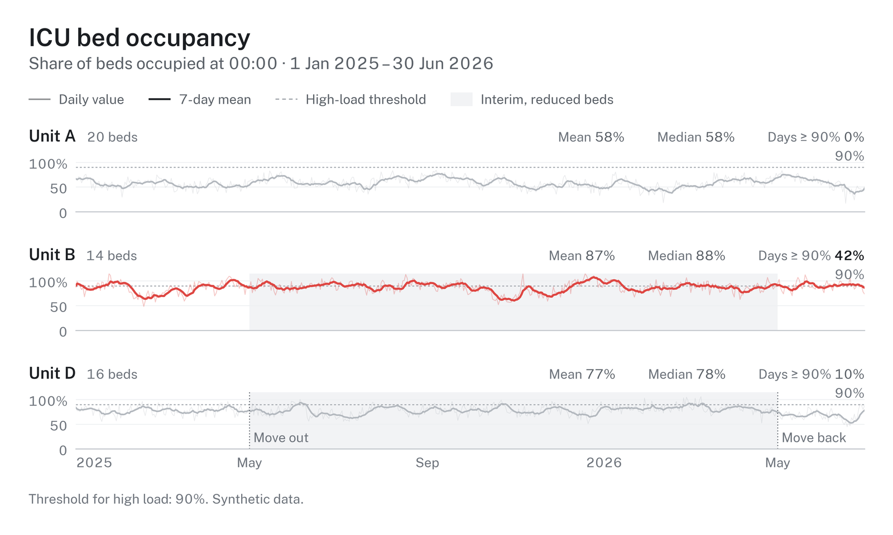
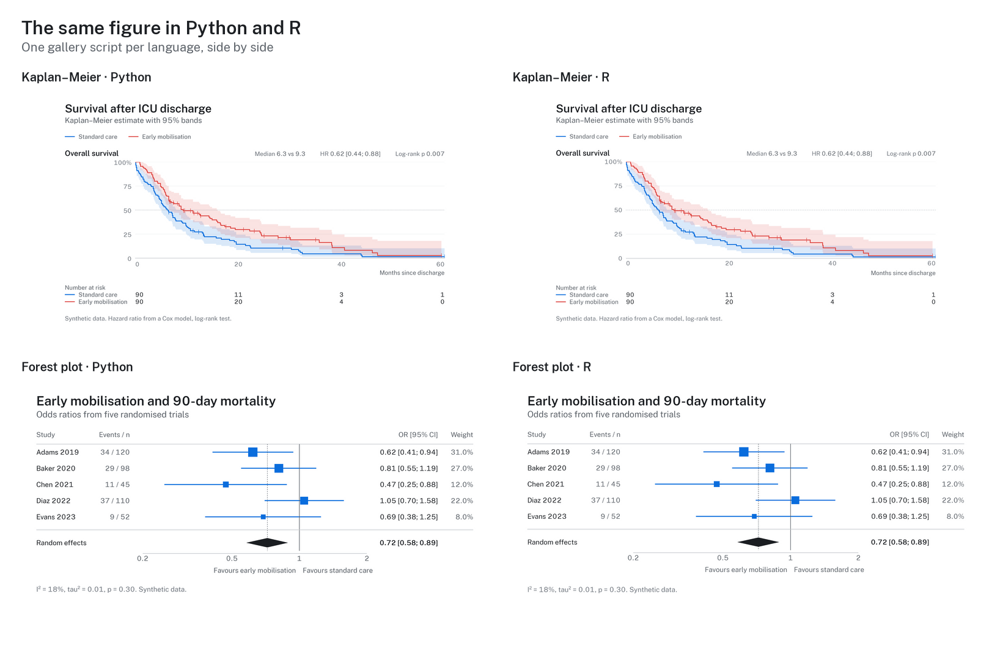

# hairline

Clean, predictable figures for medical and data science, built on 'ggplot2'. One frame for titles, legends,
panels and captions, one type scale, colour-vision checked palettes, and print-ready files. The Python package
of the same name draws the same figures from the same design tokens, so an R figure and a Python figure in one
manuscript match.

```r
pak::pak("schradern/hairline/r")
```

That installs the development version from GitHub; the package is not on CRAN yet.

R 4.3 or later with 'ggplot2' 4.0 or later. The bundled font, Hairline Sans, needs no installation for PNG,
SVG and HTML; for PDF on macOS without XQuartz, run `hl_install_font()` once.



## From data to a result

Most studies need the same few results: a cohort description, a comparison between groups, effects, events
over time. `hl_study()` takes a data frame once, with the role of each column, checks the data, and returns
each result as a figure, a table, the key values and a sentence for the text.

```r
library(hairline)

set.seed(1)
cohort <- data.frame(arm = rep(c("Standard care", "Early mobilisation"), each = 40),
                     age = round(rnorm(80, 64, 12)), sex = sample(c("Female", "Male"), 80, TRUE),
                     months = round(rexp(80, 0.05), 1), died = rbinom(80, 1, 0.4))
study <- hl_study(cohort, group = "arm", time = "months", event = "died",
                  units = c(age = "years", months = "months"))

table_one <- hl_describe(study)    # Table 1: median (IQR) and n (%) per group
table_one$table                    # a data frame
age <- hl_compare(study, "age")    # spread rows per group, Wilcoxon rank-sum
age$text                           # "Age (years), median (IQR): ... (Wilcoxon rank-sum, p = ...)."
age$numbers$test$p                 # the unrounded p the text formats
survival <- hl_survival(study)     # Kaplan-Meier with numbers at risk and the log-rank test
hl_save(survival$figure, "survival")              # survival.pdf and survival.png
```

Printing a study lists its checks: missing values, duplicate ids, categories that differ only in case,
small groups, numeric columns without a unit. Errors stop the analysis; warnings name the fix. With `id =`,
`hl_describe()`, `hl_compare()` and `hl_distribution()` refuse a variable with more than one row per id, so
repeated measurements are not counted as separate patients.

## Charts

Each chart is one call with the data and its column names, and returns a ggplot in the hairline frame:
`hl_bars()`, `hl_scatter()`, `hl_timeseries()`, `hl_spread()`, `hl_raincloud()`, `hl_ridgeline()`,
`hl_kaplan_meier()`, `hl_forest()`, `hl_dotplot()`, `hl_funnel()`, `hl_correlation()`, `hl_donut()`,
`hl_partition()`, `hl_sankey()`, `hl_chord()`, `hl_arcs()`, `hl_venn()`, `hl_prisma()`, `hl_risk_of_bias()`,
`hl_lanes()`, `hl_levels()`, `hl_swimlanes()`, `hl_likert()` and `hl_table()`.

```r
admissions <- data.frame(diagnosis = c("Sepsis", "Sepsis", "Trauma", "Cardiac", "Cardiac"),
                         sex = c("Female", "Male", "Male", "Female", "Male"))
figure <- hl_bars(admissions, "diagnosis", by = "sex", subtitle = "Admissions, 2025")
hl_save(figure, "admissions", formats = c("pdf", "png", "svg", "html"))
```

For anything else, `theme_hairline()` puts the same frame around your own ggplot:

```r
library(ggplot2)
figure <- ggplot(mtcars, aes(wt, mpg)) + geom_point() +
  labs(title = "Fuel use by weight", x = "Weight (1000 lb)", y = "Miles per gallon") +
  theme_hairline()
hl_save(figure, "fuel", size = "single")
```

## For reports

What a real report needs is one argument on the chart, and the caption says in the figure's locale what was left
out or drawn differently ("Unvollständig, heller: 2021 (2 Monate)", "Not shown (under 10): …").

```r
hl_bars(cases, "year", "cases", facet = "procedure", scales = "free", columns = 2,   # one panel per procedure
        partial = c("2021" = "2 months", "2026" = "10 months"))                     # incomplete years lighter
hl_bars(locations, "place", facet = "procedure", top = 6)                           # the rest as one "Other" bar
hl_bars(patterns, "procedure", by = "pattern", stacked = TRUE, normalize = TRUE)    # shares from counts, n kept
hl_spread(doses, "procedure", "mg", show_n = TRUE, min_n = 10, clip = 0.99,         # n, small groups out, outliers
          stats = c("median", "levels"), discrete = TRUE)                           # the frequent doses, on levels
hl_bars(cases, "year", by = "row", color_by = "procedure")                          # 12 rows, 4 colours
hl_scope("pattern", hl_bars(patterns, "pattern"))                                   # off the procedures' slots
```

- **`facet =`, `scales =`, `columns =`** on `hl_bars()`: one panel per value, each with its own value axis or one
  shared axis, the panel header with the facet's total. `top =` and `other =` fold the smallest categories.
- **`partial =`** on `hl_bars()` and `hl_timeseries()`: incomplete periods drawn lighter, named in the caption.
- **`show_n =`** on `hl_bars()`, `hl_spread()` and `hl_ridgeline()` (`n =` column on `hl_dotplot()`): the n after
  the label or in the numbers column; colours and `order` keep keying on the bare group.
- **`min_n =`** on `hl_spread()`, `hl_ridgeline()` and `hl_raincloud()`; **`clip =`** (a quantile, or
  `c(low, high)`) on those and `hl_scatter()`. The statistics use every value unless `clip_stats = TRUE`.
- **`color_by =`** on every chart with groups, **`dimension =`** or `hl_scope()` across figures.
- **`stats = c("levels", …)`** and **`discrete = TRUE`** on `hl_spread()`: the most frequent values with their
  shares, and quantiles on the data's own levels. `hl_spread()` and `hl_describe()` warn when a median falls
  between two large levels and matches neither.
- **`hl_table(data, …)`**: any data frame (or `hl_describe()$table`) in hairline's typography, numbers in the
  locale, `bold_rows =`, `footnotes =`, saved as PDF, PNG, SVG and as a real HTML table.
- **`hl_report()`**: figures and tables numbered in the locale ("Abbildung 1", "Tabelle 2") in one Markdown or
  HTML file with the images embedded (`hl_report_add()`, `hl_report_write()`).

### Over the time of day

```r
lanes <- hl_lanes(stays, "place", "start", "end", group = "section", days = "weekdays", flows = moves,
                  spans = list("Regular hours" = c(7, 16)))
staff <- hl_levels(staff, "start", end = "end", by = "role", days = "weekdays")
figure <- hl_rows(lanes, staff, heights = c(9, 3, 4), title = "Occupancy and staffing")
hl_save(figure, "unit_day", size = "double")
```

- **`hl_lanes()`**: one row per place, each 15-minute cell coloured by the share of days it was occupied, in its
  section's ramp, binned as the key in the legend row (`hl_legend_ramp()`); `flows =` adds the moves between rows
  as faint connectors.
- **`hl_levels()`**: whole counts of people as steps: how often exactly 1, 2, 3 … were needed, the typical day and
  the count that is enough on 9 of 10 days, on the data's levels (quantile type 1).
- **`hl_swimlanes()`**: one real day, a bar per interval with its label inside where it fits, an inner interval as
  a darker band, and `assign = "first_free"` to turn tasks into rows of people.
- **`hl_rows()`** stacks plots as panel rows sized by `heights` on one time axis, labelled once at the bottom, with
  one legend row and caption: the R counterpart of the Python `figure(heights=, sharex=)` with `into=`.

### Surveys

```r
hl_likert(survey, "statement", "rating", levels = 1:10, group = "section",            # 1-2, 3-5 | 6-8, 9-10
          reverse = "Waited too long on the day")                                     # recoded and marked
hl_spread(importance, "feature", "rating", section = "area", panel_letters = TRUE,    # a, b, c blocks
          mean = TRUE, sort = "median")                                               # mean as an open diamond
hl_bars(sources, "answer", facet = "question", respondents = "respondent",            # % of respondents, n per panel
        context = "None of these", header = "n")                                      # the exclusive answer in grey
hl_bars(answers, "question", "count", by = "answer", stacked = TRUE, percent = TRUE,  # each answer named inside,
        inside = "name", show_n = "column")                                           # n in a column on the right
```

- **`hl_likert()`**: diverging bars for rating scales, the levels in a few named bins (a ten-point scale reads
  1–2, 3–5 | 6–8, 9–10), a middle level centred on the split, negatively worded items recoded and marked, sections
  as blocks, median, IQR and n beside each row, the binned key in the legend row.
- **`hl_spread(section =, panel_letters =, mean =, sort = "median")`**: rows in lettered blocks, the mean as an open
  diamond beside the median dot, rows ordered by median.
- **`hl_bars(respondents =)`** counts each respondent once per answer, as a share of the panel's respondents, and
  says that several answers were possible; **`context =`** draws an answer outside the ranking in grey;
  **`header = "n"`** gives each facet its n; **`show_n = "column"`** writes each bar's n right of it;
  **`inside = "name"`** names each stacked segment inside it, so rows may hold different answers.

## Options every chart shares

The same question gets the same option in every chart that has the concept: `order`, `sort`, `colors`,
`highlight`, `key_title`, `x_title`, `y_title`, `reference`, `percent`, `show_n`, `min_n`, `clip` and `facet`.
`reference = c(Target = 0.9)` draws labelled dashed lines on the value axis, `highlight = "Unit B"` greys the other
groups, `facet = "site"` draws a panel per site (a block of rows on spread, dot plot and Likert). The
[options guide](../docs/guide/options.md) shows which chart has which; `?chart_option_params` documents them once.

## Colours

Groups take a palette's colours in order, so two groups always get the same two colours and a group keeps its colour
in every chart. `hl_palettes()` lists the six palettes, the purpose sets (two groups, greyscale print, risk of bias)
and the ramps for amounts; `hl_swatches()` draws them; `hl_use(palette = "calm")` changes the default;
`hl_use(colors = c("Unit B" = "#e79d01"))` pins a colour to a name; `colors = "blues"` on a chart gives ordered
groups the steps of one ramp; `scale_fill_hairline_c("blues")` gives a ramp to your own ggplots. `?hairline_colours`
has the details.

## Files

`hl_save()` writes PDF, PNG and TIFF (600 dpi by default), SVG (text kept as text) and self-contained
interactive HTML with tooltips. Files carry the figure's title and subtitle as their description, and no
timestamps.

## Design

- `hl_use(brand = "_brand.yml")` applies an institution's colours, fonts and sizes from a
  [brand.yml](https://posit-dev.github.io/brand-yml/) file; several files layer from institution to document.
- `hl_use(colors = c("Unit B" = "#e79d01"))` pins a colour to a name across every chart.
- Palettes are checked for colour-vision separation and contrast; `hl_check_palette()` reports the numbers.
- `hl_use(scheme = "dark", accent = "#0b6e4f")` draws on a dark surface with an accent for single series.

## Gallery

More figures, Python and R side by side, and the colour guide: [https://github.com/schradern/hairline](https://github.com/schradern/hairline).



## Author

Nikolas Schrader (<hi@nikolasschrader.com>), ORCID [0009-0001-4616-3804](https://orcid.org/0009-0001-4616-3804).

## How to cite

If hairline helped you make the figures in your work, please cite it; `citation("hairline")` prints the
reference:

```bibtex
@Manual{schrader2026hairline,
  title = {hairline: Clean, Predictable Figures for Medical and Data Science},
  author = {Nikolas Schrader},
  year = {2026},
  note = {R package version 0.2.1},
  doi = {10.5281/zenodo.23456211},
}
```

## Licence

MIT. The bundled Hairline Sans font is a modified Public Sans (SIL Open Font License 1.1); see
`inst/COPYRIGHTS`.
